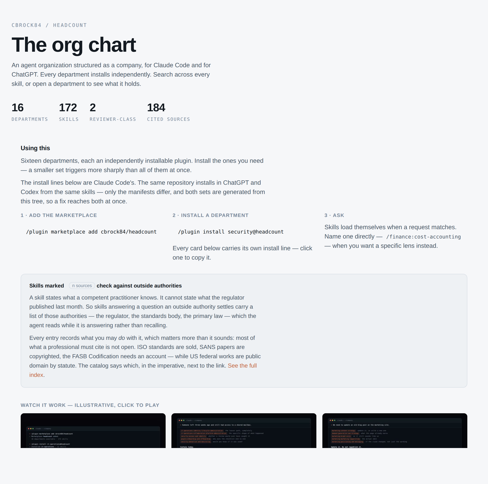

> **[中文化] headcount**
>
> 此项目是 [cbrock84/headcount](https://github.com/cbrock84/headcount) 的中文翻译版本。
> - 原项目 Stars: 2047
> - 主语言: Markdown
> - 许可证: MIT
> - 翻译日期: 2026-10-14
> - 原始 README: [README_en.md](README_en.md)
>
> 说明：下方 README 正文为**原项目文档的中文翻译**，力求忠于原文；本页顶部的「中文快速上手」为**面向中文用户的补充导读**（非原文内容），目的是让你不用读完整篇 README 就能先把项目跑起来。
>
> 如有翻译不准确之处，欢迎提 Issue 或 PR。

---


## 🚀 中文快速上手（补充导读，非原文）

### 这是什么 / 解决什么问题

headcount 是一个「以公司组织架构来组织 AI 技能」的库：一个首席执行官之下设 16 个部门、共 172 项技能（skills）。每个部门都是可独立安装的插件，项目只加载自己需要的功能，而不是一次性全部加载。它解决的是「把一堆提示词堆在一起」的问题——按部门安装、按 `department:skill` 寻址，让不同领域的专家在请求匹配时自动加载。

### 快速上手（最短路径）

1. 在 Claude Code 中添加 marketplace：
   ```
   /plugin marketplace add cbrock84/headcount
   ```
2. 按需逐个安装部门（示例）：
   ```
   /plugin install security@headcount
   ```
   或安装其他部门，例如：
   ```
   /plugin install it-operations@headcount
   ```
3. 直接用自然语言提问，匹配到的技能会自动加载，例如问「why isn't this landing page converting?」会加载 `demand-generation:landing-page-cro-expert`。
4. 想指定某个技能时，按名称直接调用，例如：
   ```
   /finance:financial-modeling
   ```
5. 若使用 ChatGPT / Codex：同一仓库，把它添加为 plugin marketplace（ChatGPT 读取的 manifest 在 `.agents/plugins/marketplace.json`），或把想要的部门复制到自己项目的 `.agents/skills/` 目录下。

（原文未提供除上述之外的安装/启动命令。）

### 环境要求

- 操作系统：原文未说明。
- 硬件：原文未说明。
- 依赖：需要运行在 Claude Code，或 ChatGPT / Codex 中。
- 版本要求：原文未说明。
- 国内网络环境提示：原文未提及镜像源或加速下载相关内容。

### 常见坑与注意事项

- 需要特定平台：技能运行在 Claude Code 和 ChatGPT / Codex 中，两边的技能文件相同，只有 manifest 不同。
- ChatGPT / Codex 侧有上下文预算限制：技能描述共享约 8000 字符的上下文预算，而全部 16 个部门合计约 50000 字符，因此「只装会用到的部门」不只是更整洁，而是唯一可行的做法。
- 安装部门不会改动你的项目：它只是给助手增加技能，不会写入你的仓库、添加依赖或自行运行任何东西。
- 暂无明显坑点（除上述外，原文未提及需 API Key、需下载大文件等其他限制）。

---


---

<h1 align="center">headcount</h1>

<p align="center"><b>加一个部门，而不是加一条提示词。</b></p>

<p align="center">
  <a href="AGENTS.md"></a>
  
  
  <a href="docs/SOURCES.md"></a>
  <a href="LICENSE"></a>
</p>

<p align="center">
  <a href="https://github.com/cbrock84/headcount/actions/workflows/checks.yml"></a>
  <a href="https://github.com/cbrock84/headcount/stargazers"></a>
  <a href="https://github.com/cbrock84/headcount/graphs/contributors"></a>
  
  
  <a href="CONTRIBUTING.md"></a>
</p>

<p align="center">
  <a href="https://cbrock84.github.io/headcount/org-chart.html">
    <picture>
      <source media="(prefers-color-scheme: dark)" srcset="docs/assets/org-chart-dark.png">
      
    </picture>
  </a>
</p>

<p align="center">
  <a href="https://cbrock84.github.io/headcount/org-chart.html"><b>打开交互式组织架构图</b></a> — 搜索每项技能，展开部门，跳转到来源。
</p>

一个按公司结构组织的智能体组织：一位首席执行官，下辖
16 个部门，共 172 项技能。

每个部门都是可独立安装的插件，因此项目只加载所需的功能，
而不是一次性加载全部。

## 安装

**[Claude Code](https://claude.com/claude-code)**

```
/plugin marketplace add cbrock84/headcount
/plugin install security@headcount
```

**ChatGPT 和 Codex** — 同一个仓库。将其添加为插件市场，或把
你想要的部门放入自己项目的 `.agents/skills/` 中。

两者的技能完全相同，只有清单文件不同，且两套清单都从
本目录树生成，因此一次修复会同时到达两边。参见 `AGENTS.md`。

按项目需要安装任意数量的部门。技能以 `department:skill` 寻址 —
`security:threat-modeling`、`finance:unit-economics` — 因此名称永不冲突。

## 使用

当请求匹配时，技能会自动加载。在某个部门的领域内提问，
对应的专家就会介入：

| 你的提问 | 加载内容 |
|---|---|
| "为什么这个落地页转化率不高？" | `demand-generation:landing-page-cro-expert` |
| "在开始构建前审查一下这个设计" | `security:threat-modeling` |
| "我们负担得起这次招聘吗？" | `finance:unit-economics` |
| "我们的增长停滞了" | `executive:business-growth-consultant` |

想要特定视角时，可直接按名称调用：`/finance:financial-modeling`。

初次使用？[docs/GETTING-STARTED.md](docs/GETTING-STARTED.md) 介绍了应先安装哪些部门、
调用技能的三种方式，以及审查类部门有何不同。

十一个跨部门场景 — 企业客户提出的 SOC 2 要求、两个站点之间的链路中断、
因无人负责日期而自动续订的合同 — 在 [docs/USE-CASES.md](docs/USE-CASES.md) 中
从头到尾完整演练，包括返回什么结果，以及审查类部门在何处叫停工作而非
仅仅添加意见。

每个部门还在 `.claude/agents/` 中附带一份智能体章程，因此部门可以作为
子智能体被委派，拥有自己独占的写入范围。

## 部门

<details>
<summary><b>首席执行官办公室</b>（首席执行官）— 7 项技能</summary>

| 技能 | 作用 |
|---|---|
| `agent-hierarchy` | 为仓库设计编排器与子智能体层级 — 按独占写入范围拆分智能体，为每个生产者配备独立审计者，一个…… |
| `ai-research-analyst` | 产出高管级研究 — 市场规模、竞争对手图谱、趋势分析和战略情报 — 基于引用来源，并给出置信度…… |
| `business-growth-consultant` | 找出当前限制企业增长的单一约束条件，以及针对它的最高杠杆举措，而非列出一堆可能…… |
| `ceo-advisor` | 在决策、计划或想法被采纳前对其进行压力测试 — 揭示其所依赖的假设、反对理由，以及需要满足什么条件才…… |
| `chief-executive` | 设定方向，分配资本和注意力，做出无人能替代的决策。 |
| `fundraising-and-investor-relations` | 筹集资本并在之后管理关系 — 决定融多少及为什么，理解稀释和优先权条款的实际成本，以……推进流程 |
| `saas-idea-validator` | 从问题、市场、竞争、变现、防御性和执行力等方面评估软件或创业想法，返回结论而非鼓励…… |

</details>

<details>
<summary><b>技术</b>（CTO / CIO）— 19 项技能</summary>

| 技能 | 作用 |
|---|---|
| `ai-workflow-architect` | 为企业设计 AI 系统、自动化和智能体工作流 — 识别哪些人工工作值得自动化，如何构建系统，哪些工具适…… |
| `api-design` | 设计能经受住消费者考验的接口 — 资源建模、错误、版本管理、分页和兼容性。 |
| `branch-and-worktree-workflow` | 将功能工作隔离在独立分支或工作树中，完成后干净地集成。 |
| `chief-technology-officer` | 负责架构、工程交付、基础设施、数据平台和内部系统。 |
| `cloud-infrastructure` | 设计和运行云基础设施 — 环境、基础设施即代码、网络与隔离、扩缩容和成本。 |
| `code-review` | 进行和回应代码审查 — 审查变更的正确性、设计和风险，以及评估自己工作收到的审查反馈。 |
| `completion-verification` | 在声称工作完成前验证其确实完成 — 运行检查、阅读输出，确认原始请求已满足，而非…… |
| `data-migration` | 将数据从一个系统迁移到另一个系统而不丢失或损坏 — 在映射前分析源数据，决定采用一次性切换还是并行运行…… |
| `implementation-planning` | 将规格或需求转化为独立的会话或智能体可执行的书面计划，然后推动该计划通过审查检查点。 |
| `observability-and-reliability` | 使系统可调试且可靠运行 — 埋点、值得半夜叫醒的告警、服务目标和从故障中学习。 |
| `parallel-agent-delivery` | 将工作拆分到多个同时运行的智能体或会话，保持各自范围不重叠，使结果干净合并。 |
| `prompt-optimizer` | 将粗略意图或薄弱提示词转化为可靠的提示词 — 诊断输出不一致的原因，重构指令，并适配不同模型。 |
| `release-and-deployment` | 安全且频繁地发布变更 — 流水线、部署策略、功能开关、回滚和数据库变更。 |
| `skill-authoring` | 编写和修订智能体技能，使其在正确时机触发，并在触发时给出可用的指令。 |
| `solution-architecture` | 设计系统结构并使架构决策可辩护 — 边界、耦合、权衡，并记录原因。 |
| `solution-exploration` | 在写任何代码前探索问题和可能的方法范围 — 澄清实际被要求的内容，呈现各选项及其权衡…… |
| `systematic-debugging` | 在提出任何修复前找出 bug、测试失败或异常行为的根本原因。 |
| `technical-debt-management` | 使技术债务可见且可决策 — 区分真正的债务与混乱，量化其成本，并用业务语言论证修复。 |
| `test-driven-development` | 通过先写失败的测试来驱动实现，然后写通过测试的最小代码。 |

</details>

<details>
<summary><b>安全</b>（CISO）— 8 项技能 · **审查类**</summary>

| 技能 | 作用 |
|---|---|
| `access-and-identity` | 设计和审计谁能访问什么 — 认证、授权模型、特权访问、服务凭证和入转离流程。 |
| `chief-information-security-officer` | 负责组织的安全态势 — 架构、项目战略、风险接受、事件指挥，以及叫停产生不可接受……的工作的权力 |
| `data-protection-and-encryption` | 保护数据本身而非其周围系统 — 对持有的数据进行分类，在传输和静态时加密，并理解每种方式实际防御…… |
| `detection-and-monitoring` | 构建发现进行中攻击的能力 — 决定记录和保留什么，集中到防篡改的地方，编写在……时触发的检测规则 |
| `incident-response` | 从检测到关闭运行安全事件 — 分诊、遏制、调查、沟通和事后复盘。 |
| `security-architecture-review` | 在发布前审查设计或变更的安全性 — 认证与授权、数据处理、密钥、依赖和安全开发实践…… |
| `threat-modeling` | 在系统构建或变更前识别可能出错的地方 — 值得攻击的资产、入口点、信任边界和控制措施…… |
| `vulnerability-management` | 运行从发现弱点到确认修复的闭环 — 扫描、分诊、按真实可利用性排优先级、修复跟踪和补丁策略。 |

</details>

<details>
<summary><b>IT 运维</b>（CIO）— 12 项技能</summary>

| 技能 | 作用 |
|---|---|
| `backup-and-recovery` | 保护和恢复数据 — 备份覆盖范围和范围、保留策略、防勒索软件的不可变性，以及证明恢复确实有效。 |
| `chief-information-officer` | CIO 的职责 — 运行公司赖以工作的技术、服务质量、IT 支出，以及与产品工程的边界。 |
| `cloud-administration` | 管理公司运行所用的云而非其销售的云 — 租户和订阅结构、SaaS 资产及每个应用的所有者、以身份为…… |
| `collaboration-platform-administration` | 管理组织运行所用的邮件、聊天、会议和文件共享平台 — 租户和域名配置、邮件认证和路由、钓鱼…… |
| `endpoint-management` | 管理笔记本电脑、台式机和移动设备 — 注册、配置、补丁、软件分发，以及丢失或受损设备。 |
| `identity-lifecycle-administration` | 执行入职、转岗和离职流程 — 配置、组成员资格、角色变更时的访问变更，以及完整的取消配置。 |
| `it-asset-management` | 跟踪硬件和软件资产的全生命周期 — 采购、所有权、许可、更新和处置。 |
| `network-administration` | 设计和运营企业网络 — 分段、远程访问、无线、DNS 和寻址，以及诊断网络问题。 |
| `service-desk` | 运行 IT 服务台 — 受理、分诊、优先级排序、升级、知识库，以及改善服务而非扭曲服务的指标。 |
| `systems-administration` | 运行服务器和企业系统 — 补丁、配置基线、变更控制、容量，以及预防事件的日常规程。 |
| `telephony-and-conferencing` | 运行语音和会议基础设施 — 电话系统和号码、紧急呼叫义务、会议室及其音视频、通话录音及其保留…… |
| `virtualization-operations` | 运行服务器之下的虚拟机监控程序层 — 主机容量和整合比、虚拟机蔓延、快照纪律、弹性和实时迁移，以及许可…… |

</details>

<details>
<summary><b>产品</b>（CPO）— 11 项技能</summary>

| 技能 | 作用 |
|---|---|
| `brand-identity` | 定义和应用视觉品牌 — logo 使用、配色、字体、图像方向，以及保持产品和营销表达一致的指南…… |
| `chief-product-officer` | 负责构建什么及为什么：产品战略、路线图、发现、用户体验，以及每个发布版本的成功定义。 |
| `design-styles` | 为界面应用刻意的视觉方向 — 极简编辑风、工业实用风或高质感商业风 — 各有自己的字号体系、配色…… |
| `design-system` | 构建和维护产品组装所用的设计系统 — 颜色、字体、间距和层级的 token、组件契约，以及保持……的规则 |
| `interface-craft` | 提升界面的视觉和交互质量 — 布局、层级、字体、间距、密度，以及区分精心设计与通用产品的细节…… |
| `interface-redesign` | 在不重建的前提下将现有界面升级到更高标准 — 审计现状，识别哪些显得通用或未完成，并排序…… |
| `presentation-design` | 设计承载论点而非装饰论点的幻灯片和单页文档 — 演示结构、陈述要点的标题、传达单一信息的图表…… |
| `product-discovery` | 在构建前发现问题是真实的且解决方案可行 — 招募合适的人、不带引导地访谈、区分…… |
| `product-requirements` | 写下正在构建的内容，使团队能构建并知道何时完成 — 先问题与成功指标后方案，通过排除法界定范围，用户可见…… |
| `ux-product-auditor` | 审计网站、应用、引导流程或设计的可用性、转化和产品问题，将每个发现与业务成果和严重程度挂钩。 |
| `visual-reference-generation` | 在实现前产出设计参考图 — 网页或移动端的界面概念、布局方向和流程，使口头简报足够具体…… |

</details>

<details>
<summary><b>营销</b>（CMO）— 19 项技能</summary>

| 技能 | 作用 |
|---|---|
| `behavioral-marketing` | 将决策科学和认知偏差研究应用于营销和产品决策 — 人们在不确定下实际如何选择，以及框架、默认值、……如何影响 |
| `brand-voice` | 捕捉个人或品牌实际的写作方式，并将其转化为其他内容技能都可引用的可复用语气指令。 |
| `chief-content-officer` | 将内容作为运营来管理 — 生产流水线、编辑日历、再利用引擎、竞品内容情报，以及对现有内容的审计。 |
| `chief-marketing-officer` | 负责品牌、需求生成、内容、传播，以及市场如何理解企业的业务。 |
| `content-strategy` | 决定做什么内容及为什么 — 主题领域、格式组合、节奏，以及内容如何连接到业务成果而非流量。 |
| `customer-research` | 规划、执行和综合客户研究 — 访谈、调查、赢单/输单分析和信息测试 — 转化为改变决策的发现。 |
| `events-and-field-marketing` | 规划和运生产出管道的活动 — 会议、展会、网络研讨会、外勤项目，并衡量其中哪些有效。 |
| `marketing-campaign-planner` | 围绕一个故事设计协调的多渠道活动或产品发布 — 目标、信息、渠道排序、时间线、素材，以及确保……的清单 |
| `marketing-copywriting` | 为任何场景撰写和编辑营销文案 — 首页、产品和定价页、广告、邮件和宣传材料 — 并打磨效果不佳的现有文案。 |
| `marketing-planning` | 构建正式营销计划 — 目标、渠道组合、预算分配、排序，以及判断是否有效的衡量方式。 |
| `newsletter-writer` | 撰写和编辑人们真正会打开的新闻通讯和营销邮件 — 主题行、开头、结构、语气，以及转化转折点。 |
| `partnership-marketing` | 通过他人的受众建立触达 — 联合营销合作、创作者和网红项目，以及社区建设。 |
| `positioning-and-messaging` | 确立产品被理解为什么、面向谁、替代什么 — 然后转化为其他所有场景继承的信息。 |
| `product-launch` | 将已构建的东西推向市场 — 按实际价值分级发布，在对外公告前先完成内部就绪…… |
| `public-relations` | 规划和执行赢得媒体 — 新闻策略、记者外联、公告、评论和危机应对。 |
| `social-post-craft` | 端到端撰写、构建和评估社交帖子 — 钩子、正文、按各平台渲染方式的格式化，以及发布前的质量检查。 |
| `video-content` | 规划和编写短视频和长视频脚本，并设计包装 — 标题、缩略图和开头 — 决定是否被观看。 |
| `visual